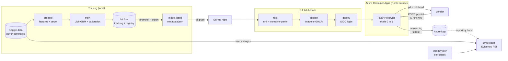
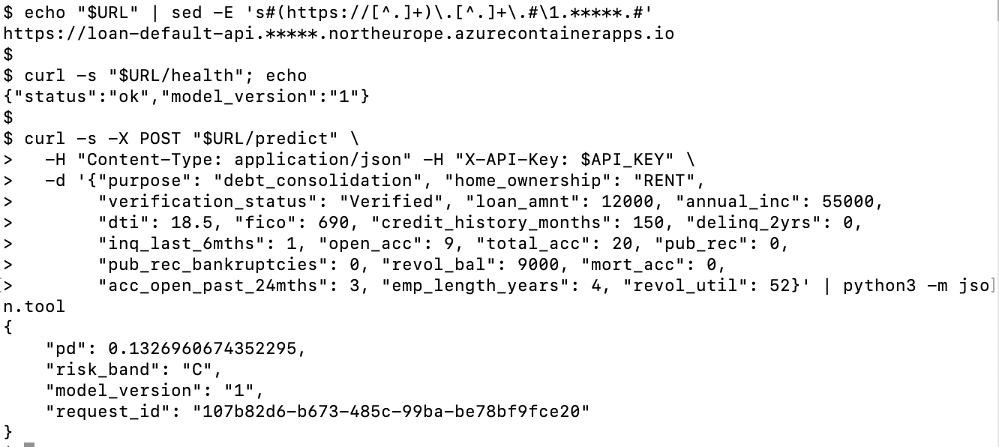

# Loan default scoring service

[](https://github.com/mimmospoto/loan-default-scoring/actions/workflows/ci.yml)
[](https://github.com/mimmospoto/loan-default-scoring/actions/workflows/drift.yml)


[](LICENSE)

A credit default model taken from training to a live, monitored API. The
model is deliberately simple; the engineering around it is the point.

**Status:** complete (all 9 phases). The model trains, is versioned, and is served with FastAPI in a container. CI tests it and deploys it to Azure Container Apps. A drift report compares live and later data with the training data. A challenger model must pass a gate before it can replace the champion.

## What it does

A lender sends a loan application and receives a calibrated probability of
default and a risk band (A–E).

- [docs/framing.md](docs/framing.md): target, cohort, validation split, and
  feature rules.
- [docs/model.md](docs/model.md): model design and out-of-time results.
- [docs/registry.md](docs/registry.md): how a model version goes live.
- [docs/api.md](docs/api.md): endpoints, input rules, and design decisions.
- [docs/docker.md](docs/docker.md): the image, and how it is tested against training.
- [docs/ci.md](docs/ci.md): what CI runs and why the model is committed.
- [docs/deploy.md](docs/deploy.md): how it is deployed to Azure, cost, and why no Kubernetes.
- [docs/monitoring.md](docs/monitoring.md): what is monitored, the drift report, and what it cannot see.
- [docs/retraining.md](docs/retraining.md): how a challenger model is tested against the champion, and the promotion gate.

On loans issued in 2015, unseen in training, the model reaches an AUC of
0.681 (Gini 0.362), against 0.674 for a logistic regression baseline.
Observed default rates rise from 4.9% in band A to 26.8% in band E.

## Architecture



- **Training stays offline.** The service never touches MLflow or the data; it
  loads two exported files.
- **One image is one model version.** CI builds the image from the committed
  model and tests that it predicts exactly like the training code.
- **Deploys are automatic** after the tests pass.
- **Monitoring** compares the training data with later vintages or with the
  request log. The monthly job tests the report itself on made-up traffic. The
  dashed line is manual; see [docs/monitoring.md](docs/monitoring.md).

## Design decisions

The reasoning is in the docs. The choices a reviewer is most likely to ask about:

- **Out-of-time validation, not a random split.** Train on 2012–2014 loans, test on
  2015. A random split would let the model see the future. See
  [framing](docs/framing.md).
- **Leakage and fairness by design.** Lending Club's own grade, interest rate and
  installment are excluded because they come from its own risk model. Geography and
  free text are excluded because they can proxy protected attributes. No fairness
  audit is done; see [monitoring](docs/monitoring.md#what-it-cannot-see).
- **A simple, calibrated model.** LightGBM beats a logistic regression by only 0.7
  AUC points, and probabilities are calibrated so that bands mean something. See
  [model](docs/model.md).
- **The service needs only two files.** MLflow stays in training; the API loads
  `model.joblib` and `metadata.json`. A test shows the container gives the same
  predictions as the training code. See [registry](docs/registry.md) and
  [docker](docs/docker.md).
- **No Kubernetes.** One small stateless service does not need it. Azure Container
  Apps gives HTTPS, scale to zero and revisions. See [deploy](docs/deploy.md).
- **Promotion is a human step.** A challenger must pass a gate, and even then
  nothing is exported or deployed automatically. In the run so far, none passed.
  See [retraining](docs/retraining.md).

## Live endpoint

The service is deployed on Azure Container Apps (North Europe). Its address and
API key are not published here, to keep it from being scanned and billed. Ask
the author for both; see [docs/deploy.md](docs/deploy.md) for the setup and cost.

A call to the live service (address partly hidden):



## Try it

The trained model is in the repo, so scoring needs no data and no training.

```bash
git clone https://github.com/mimmospoto/loan-default-scoring.git
cd loan-default-scoring
docker build -t loan-default .
docker run --rm -p 8000:8000 loan-default
```

Then open [http://127.0.0.1:8000/docs](http://127.0.0.1:8000/docs) and use
"Try it out" on `POST /predict`, or send a request:

```bash
curl -X POST http://127.0.0.1:8000/predict -H "Content-Type: application/json" -d '{
  "purpose": "debt_consolidation", "home_ownership": "RENT",
  "verification_status": "Verified", "loan_amnt": 12000, "annual_inc": 55000,
  "dti": 18.5, "fico": 690, "credit_history_months": 150, "delinq_2yrs": 0,
  "inq_last_6mths": 1, "open_acc": 9, "total_acc": 20, "pub_rec": 0,
  "pub_rec_bankruptcies": 0, "revol_bal": 9000, "mort_acc": 0,
  "acc_open_past_24mths": 3, "emp_length_years": 4, "revol_util": 52
}'
```

The response has `pd`, `risk_band`, `model_version` and `request_id`. For the
application above it is `pd` 0.133 and band C, from model version 1. Without
Docker: `pip install -r requirements.txt`, then
`python -m uvicorn loan_default.api:app`.

## Setup

Requires Python 3.13 (see `.python-version`) and a Kaggle API token. Generate one at
[kaggle.com/settings/api](https://www.kaggle.com/settings/api) and save the
key to `~/.kaggle/access_token` (plain text, `chmod 600`), or run
`kaggle auth login`. On macOS, LightGBM also needs `brew install libomp`.

```bash
python3 -m venv .venv
.venv/bin/pip install -r requirements-dev.txt
.venv/bin/python -m loan_default.data.download  # fetches data into data/raw/
.venv/bin/python -m loan_default.data.profile   # checks the framing against the data
.venv/bin/python -m loan_default.data.prepare   # builds the modelling table
.venv/bin/python -m loan_default.train          # tunes, trains, logs to MLflow (--name, --note optional)
.venv/bin/python -m loan_default.registry promote 1   # makes version 1 the champion
.venv/bin/python -m loan_default.registry export      # writes the champion to artifacts/
.venv/bin/python -m uvicorn loan_default.api:app      # serves the API at http://127.0.0.1:8000/docs
docker build -t loan-default:dev . && docker run --rm -p 8000:8000 loan-default:dev
.venv/bin/python -m pytest                      # runs the tests
.venv/bin/python -m loan_default.drift --current-period 2017-01 2017-12   # drift report, writes reports/
.venv/bin/python -m loan_default.retrain              # challengers against the champion (nothing is saved)
```

The code is MIT licensed (see [LICENSE](LICENSE)). The data is never committed to this repository. It comes from the Kaggle
dataset `wordsforthewise/lending-club`, labelled CC0; see
[docs/framing.md](docs/framing.md#license) for the license check.

## Not in scope

This is a portfolio project, not a production credit decision system. It does
not chase leaderboard accuracy and includes no fairness audit.
